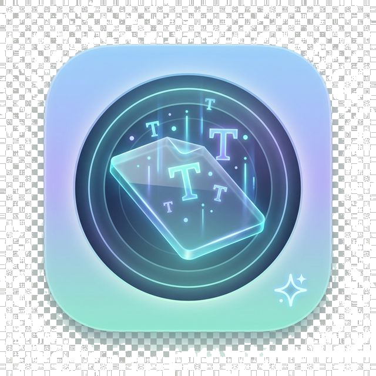
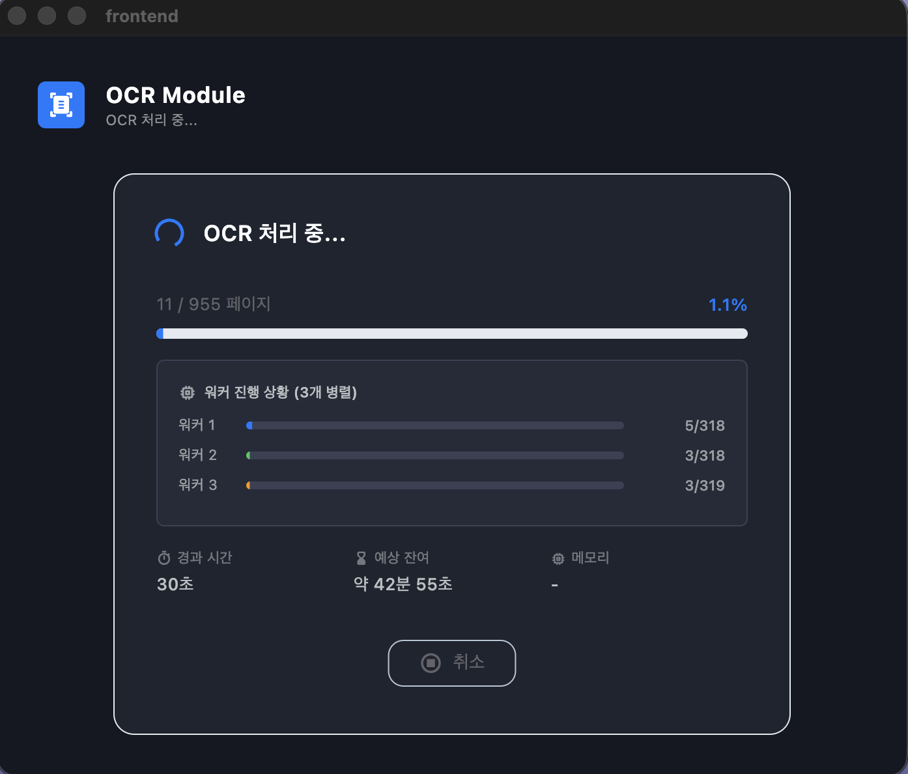

<p align="center">
  
</p>

<h1 align="center">$\bf{\large{\color{#6580DD} Mac\ Local\ AI-OCR }}$</h1>

**스캔 PDF를 로컬 AI 모델로 OCR해 검색과 복사가 가능한 PDF로 바꾸고, 필요하면 여러 권으로 나눠 저장하는 macOS 앱입니다.**

GLM-OCR 비전 모델로 텍스트를 추출한 뒤 LLM 3개가 각자 교정한 결과를 투표로 합칩니다. 모델을 처음 내려받은 뒤에는 모든 처리를 Mac 안에서 수행합니다. 전공 서적처럼 수식, 코드, 표가 섞인 문서를 대상으로 만들었습니다.

> AI 모델 없이 Apple Vision으로 빠르게 처리하는 경량판은 [Mac_OCR_APP_light](https://github.com/algocean1204/Mac_OCR_APP_light)에 있습니다.


<p align="center">
  
</p>

<hr>

## 개발 환경

### Language


### Framework


### AI & Model
-%23EE4C2C.svg?style=for-the-badge&logo=PyTorch&logoColor=white)


### OCR & PDF


<hr>

## 정식판과 경량판

| 항목 | Mac_OCR_APP (이 저장소) | [Mac_OCR_APP_light](https://github.com/algocean1204/Mac_OCR_APP_light) |
|---|---|---|
| OCR 엔진 | GLM-OCR + LLM 3개 앙상블 교정 | Apple Vision Framework |
| 모델 다운로드 | 첫 실행 시 약 15GB | 없음 |
| 권장 메모리 | 24GB 이상 | 8GB |
| 부가 기능 | PDF N권 분할 | 분할, 합치기, 페이지 추출, 작업 이력 |

<hr>

## 주요 기능

### 1. GLM-OCR 기반 텍스트 추출
- `zai-org/GLM-OCR` 모델을 transformers와 torch MPS로 실행합니다.
- 페이지를 여러 워커 프로세스에 나눠 병렬로 처리하고, 워커 수는 시스템 RAM에 맞춰 상한을 계산합니다.
- 글자 혼동 맵, 자모 다중 문자 보정, 도메인 사전으로 1차 보정을 거칩니다.

### 2. LLM 3개 앙상블 교정
- Qwen3-8B(한국어·영어), EXAONE-3.5-7.8B(고유명사·문맥), DeepSeek-R1-Distill-Llama-8B(수학·코드·표)가 각각 교정합니다. 모두 MLX 4bit 모델입니다.
- 줄 단위로 만장일치, 도메인 사전 일치, 다수결(2/3), 콘텐츠 유형별 전문 모델 순으로 최종 결과를 고릅니다.
- 콘텐츠는 한국어, 영어, 수학, 코드, 표, 혼합으로 분류합니다.

### 3. 검색 가능한 PDF 생성
- Tesseract로 원본 텍스트 위치를 찾고(PSM 6, 11, 3 순서로 재시도), 교정된 텍스트를 투명 레이어로 원본 이미지 위에 배치합니다.
- 한국어 글꼴을 함께 넣어 한국어 텍스트도 검색할 수 있습니다.
- 개별 페이지 OCR이 실패하면 이미지만 넣고 나머지 페이지를 계속 처리합니다.

### 4. 대용량 문서 처리와 분할
- 10페이지 단위 청크로 처리해 1,000페이지가 넘는 문서도 다룹니다.
- 결과 PDF를 원하는 권 수로 나누며, 경계는 10페이지 단위로 맞춥니다. (예: 100페이지를 4권으로 나누면 30, 30, 20, 20)

### 5. 순차 메모리 관리
- 모델을 하나씩 로드, 처리, 언로드해 동시에 메모리를 점유하지 않습니다.

| 단계 | 모델 | 예상 메모리 |
|---|---|---|
| OCR | GLM-OCR (워커당) | 약 8GB |
| 후처리 1 | Qwen3-8B-4bit | 약 6.5GB |
| 후처리 2 | EXAONE-3.5-7.8B-4bit | 약 6GB |
| 후처리 3 | DeepSeek-R1-Distill-Llama-8B-4bit | 약 6.5GB |

<hr>

## 처리 흐름

```
Flutter UI ── subprocess ──> backend/main.py
  Phase 1  병렬 OCR      PDF → 이미지 → GLM-OCR → 도메인 보정
  Phase 2  앙상블 교정   Qwen3 → EXAONE → DeepSeek-R1 → 줄 단위 투표
  Phase 3  PDF 생성      Tesseract 위치 감지 → 텍스트 레이어 → (선택) N권 분할
Flutter UI <── NDJSON 진행률 (stdout)
```

| 경로 | 역할 |
|---|---|
| `backend/pipeline` | 3단계 파이프라인 제어, 청크 워커, 병합 |
| `backend/ocr` | GLM-OCR 엔진, 앙상블 후처리, 보정 모듈 |
| `backend/pdf` | 이미지 추출, 검색 가능 PDF 생성, 분할 |
| `backend/config` | 설정과 모델 레지스트리 |
| `frontend` | Flutter macOS 앱 |
| `shared/types` | Flutter와 Python 사이 진행률, 오류 스키마 |

<hr>

## 설치 및 실행

요구사항: Apple Silicon Mac, RAM 16GB 이상(24GB 이상 권장), 여유 디스크 20GB 이상

```bash
brew install flutter python@3.12 tesseract poppler

git clone https://github.com/algocean1204/Mac_OCR_APP.git
cd Mac_OCR_APP
./install.sh          # venv 생성, 의존성 설치, macOS 앱 빌드

cd frontend
flutter run -d macos
```

첫 실행 때 Hugging Face에서 모델 4개(약 15GB)를 받아 `backend/AImodels/`에 저장합니다. 앱에서 PDF를 끌어다 놓고 분할할 권 수를 입력한 뒤 변환을 시작하면, 결과는 `~/Downloads`에 저장됩니다.

### CLI로 실행

```bash
source backend/.venv/bin/activate
python -m backend.main --input document.pdf
python -m backend.main --input document.pdf --split 4 --output-dir ~/Desktop
python -m backend.main --input document.pdf --post-mode korean
```

| 옵션 | 기본값 | 설명 |
|---|---|---|
| `--input` | (필수) | 변환할 PDF |
| `--output-dir` | `~/Downloads` | 결과 저장 폴더 |
| `--workers` | `1` | OCR 워커 수 (RAM 기준 상한 적용) |
| `--chunk-size` | `10` | 청크당 페이지 수 |
| `--split` | `1` | 분할 권 수 |
| `--dpi` | `200` | PDF 이미지 변환 해상도 |
| `--post-mode` | `ensemble` | `ensemble`, `korean`, `proper_noun`, `reasoning` |

<hr>

## 라이선스

[Apache License 2.0](LICENSE)
